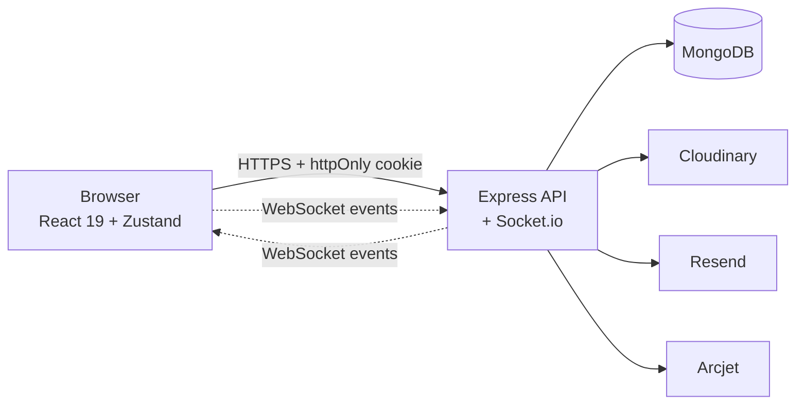
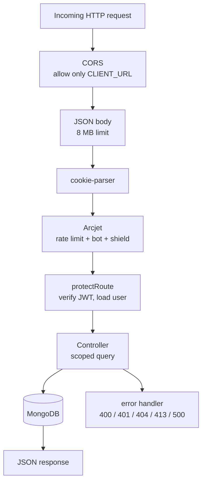
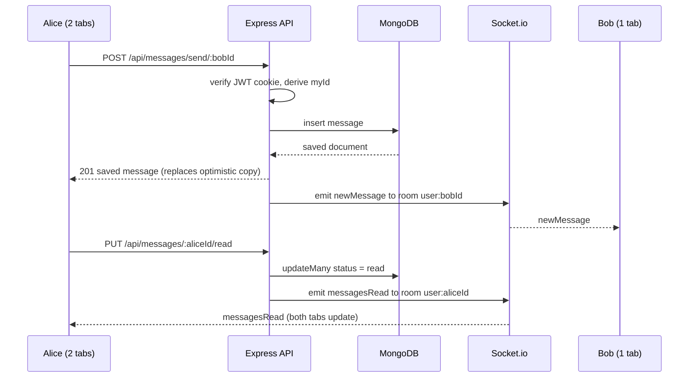

# ConvoSphere

A real-time 1:1 chat app on the MERN stack: React 19 + Vite, Express, MongoDB,
and Socket.io for delivery, typing state and read receipts.

Messages, typing events and read receipts are pushed over authenticated
WebSocket connections — not polling — and every event reaches all of a user's
open tabs, not just one. Sessions are carried in an `httpOnly` cookie, and
conversation reads are cursor-paginated so opening a chat costs the same whether
it holds 30 messages or 30,000.

> No live deployment at the moment. Run it locally with the steps below.

---

## Architecture



| Component | Responsibility |
| --- | --- |
| `backend/src/lib/app.js` | Builds the Express app without binding a port, so tests can drive it directly |
| `backend/src/lib/socket.js` | Socket.io server, handshake auth, per-user rooms, flood guard |
| `backend/src/lib/presence.js` | `Map<userId, Set<socketId>>` — one user may hold many sockets |
| `backend/src/controllers/` | Request handlers; all data access is scoped to the authenticated user |
| `frontend/src/store/` | Zustand stores plus `messageState.js`, the pure reconciliation logic |

External services are optional. Cloudinary, Resend and Arcjet fall back to
no-ops when unconfigured, so the app boots and the test suite runs with only
`MONGO_URI` and `JWT_SECRET`.

---

## Request lifecycle



Order matters. **Rate limiting runs before authentication** so an
unauthenticated flood is rejected without a database lookup. Controllers never
read a user id from the request body or params as identity — `req.user` is set
by `protectRoute` after verifying the cookie, and every query filters on it.

---

## How a message is delivered



A message arrives optimistically in the sender's UI before the request
resolves. When the response lands, the temporary message is replaced **by id**,
so a duplicate socket delivery or a concurrent send cannot drop or double it.

---

## Features

| Feature | How it works |
| --- | --- |
| Real-time 1:1 messaging | Socket.io; every socket joins `user:<id>`, so events reach all tabs |
| Typing indicators | Client emits at most once per 1.5 s, auto-stops after 2 s idle |
| Presence | Set of socket ids per user; broadcast only when a user goes online or offline |
| Read receipts | `sent → delivered → read`, stored per message and pushed to the sender |
| Auth | bcrypt (cost 10) + JWT in an `httpOnly`, `SameSite=Strict` cookie |
| History | Cursor pagination on `createdAt`, 30 messages per page, `hasMore` flag |
| Chat list | Single MongoDB aggregation returning last message + unread count |
| Images | Downscaled in the browser, then uploaded to Cloudinary |
| Welcome email | Resend; skipped entirely when no API key is set |

---

## Tech stack

| Layer | Tools |
| --- | --- |
| Backend | Node.js 20+, Express, Mongoose, Socket.io, JWT, bcryptjs, Zod, Helmet, Arcjet |
| Frontend | React 19, Vite, Zustand, Axios, Socket.io-client, Tailwind CSS, DaisyUI |
| Testing | Vitest, Supertest, mongodb-memory-server, socket.io-client |

---

## Getting started

Requires Node 20+.

```bash
git clone <your-repo-url>
cd convoSphere
```

**Backend**

```bash
cd backend
npm install
cp ../.env.example .env     # set MONGO_URI and JWT_SECRET
npm run dev                 # http://localhost:3000
```

**Frontend**

```bash
cd frontend
npm install
npm run dev                 # http://localhost:5173
```

**Production** (serves the API and the built SPA from one process)

```bash
npm run build
NODE_ENV=production npm start
```

### Environment variables

| Variable | Required | Default | Purpose |
| --- | --- | --- | --- |
| `MONGO_URI` | yes | — | MongoDB connection string |
| `JWT_SECRET` | yes | — | Signs the session token; app exits if missing or under 16 chars |
| `CLIENT_URL` | no | `http://localhost:5173` | CORS origin and the link in welcome emails |
| `PORT` | no | `3000` | HTTP port |
| `NODE_ENV` | no | `development` | `production` enables `Secure` cookies and SPA serving |
| `TRUST_PROXY` | no | `0` | Proxy hops in front of the app. Set `1` on Render/Railway/Fly, otherwise rate limiting sees the proxy IP |
| `DNS_SERVERS` | no | system resolver | Comma-separated resolvers, for networks that cannot resolve Atlas SRV records |
| `MAX_IMAGE_BYTES` | no | `5242880` | Upload ceiling after browser compression |
| `MESSAGE_PAGE_SIZE` | no | `30` | Default page size |
| `CLOUDINARY_*` | no | — | Image and avatar upload |
| `RESEND_*` | no | — | Welcome email |
| `ARCJET_KEY` | no | — | Rate limiting and bot protection; disabled without it |

Configuration is validated once at boot with Zod, so a bad variable fails
immediately with a named error instead of surfacing as a 500 on first use.

---

## API

All message routes require the `jwt` cookie.

**Auth**

| Method | Path | Description |
| --- | --- | --- |
| `POST` | `/api/auth/signup` | Create an account and set the cookie |
| `POST` | `/api/auth/login` | Log in and set the cookie |
| `POST` | `/api/auth/logout` | Clear the cookie |
| `GET` | `/api/auth/check` | Current user, or `401` |
| `PUT` | `/api/auth/update-profile` | Replace the avatar (base64 image) |

**Messages**

| Method | Path | Description |
| --- | --- | --- |
| `GET` | `/api/messages/contacts` | Everyone except the caller |
| `GET` | `/api/messages/chats` | Conversations with `lastMessage` and `unreadCount` |
| `GET` | `/api/messages/:id?limit=30&before=<ISO>` | One page of a thread, oldest first, plus `hasMore` |
| `POST` | `/api/messages/send/:id` | Send `{ text, image }` |
| `PUT` | `/api/messages/:id/read` | Mark the thread read and notify the sender |

**Socket events**

| Direction | Event | Payload |
| --- | --- | --- |
| server → client | `getOnlineUsers` | `string[]` of user ids |
| server → client | `newMessage` | The message document |
| server → client | `typing` | `{ senderId, isTyping }` |
| server → client | `messagesRead` | `{ by }` |
| client → server | `typing` | `{ receiverId, isTyping }` |

**Health:** `GET /api/health` → `{ status, uptime }`

---

## Data model

```
User     email (unique, lowercased), fullName, password (hash, select:false),
         profilePic, profilePicPublicId (select:false), timestamps

Message  senderId, receiverId, text (max 2000), image,
         status (sent | delivered | read), readAt, timestamps
```

Indexes on `Message`:

```
{ senderId: 1, receiverId: 1, createdAt: -1 }   conversation pages
{ receiverId: 1, createdAt: -1 }                unread counts, chat list
{ senderId: 1, createdAt: -1 }                  chat list
```

`password` and `profilePicPublicId` are `select: false`, so a response has to
opt in to them. That is why the password hash cannot leak through a forgotten
projection.

---

## Design decisions

**Cookie, not `localStorage`.** A token in `localStorage` is readable by any
script on the page, so one XSS bug leaks sessions. An `httpOnly` cookie cannot
be read from JavaScript; the CSRF surface that trades for is closed by
`SameSite=Strict`.

**A room per user, not a stored socket id.** Emitting to one saved socket id
delivers to exactly one tab and breaks as soon as the user opens a second. Every
socket joins `user:<id>`, so message, typing and read events fan out to all of
them.

**Cursor pagination, not offset.** `?before=<ISO>` with a compound index is a
range seek whose cost depends on page size. Offset has to skip N documents, so
later pages get slower, and a new message shifts every page under the reader.

**A set of sockets per user.** A user is online while at least one socket is
connected. A single `{ userId: socketId }` entry loses that, so closing any tab
marks the user offline while they are still connected.

**Broadcast on transitions only.** Presence is re-broadcast when a user actually
goes online or offline, not on every socket connect. With 3 tabs per user that
is 3× fewer broadcasts — and it scales with users instead of with tabs.

---

## Testing

69 automated tests: 49 backend, 20 frontend.

```bash
npm test                     # both suites
npm test --prefix backend    # 49 tests
npm test --prefix frontend   # 20 tests
```

The backend suite runs against a real in-memory MongoDB (`mongodb-memory-server`
starts an actual `mongod`) and a real Socket.io server on an ephemeral port.
Cloudinary is the only stubbed dependency, because it is a paid service.

Regression cases it locks in:

- an expired or malformed token returns `401`, not `500`
- a malformed id returns `400`, not a CastError `500`
- a third user requesting someone else's thread receives zero messages
- a user stays online while a second tab is connected, and goes offline only
  when the last one closes
- a message reaches every open tab of both sender and receiver
- the password hash never appears in any response

The frontend suite covers the pagination merge, optimistic reconciliation and
image sizing as pure functions. There is no browser end-to-end test — components
are exercised at the store level, not by driving a real browser.

CI is configured in [`.github/workflows/ci.yml`](.github/workflows/ci.yml) and
runs both suites plus `lint` and `build`. It has not executed yet.

---

## Benchmarks

`backend/bench/run.mjs` seeds a real in-memory database with 53,000 messages and
200 users, then runs the previous implementation and the current one over the
same data. The old code is kept inline in the harness, so the comparison is
against real code rather than a description of it.

| Metric | Before | After | Change |
| --- | --- | --- | --- |
| Documents read to open a conversation | 53,000 | 30 | **−99.9%** |
| Conversation response size | 864,974 B | 8,009 B | **−99.1%** |
| Presence broadcasts (500 users × 3 tabs) | 3,000 | 1,000 | **−66.7%** |
| Chat-list response time | ~800–1,010 ms | ~240–260 ms | **~68–77%** |

The first three rows are exact — a document count, a byte size and an event
count on a fixed dataset. The last row is wall-clock and varies between runs, so
quote the low end.

```bash
cd backend && npm run bench
```

Full output and methodology: [`backend/bench/RESULTS.md`](backend/bench/RESULTS.md).
This measures query and data-path cost, not concurrent-user throughput.

---

## Known limitations

- Presence and rooms live in process memory, so the app assumes a single
  instance. Horizontal scaling needs the Socket.io Redis adapter.
- The chat-list aggregation groups in MongoDB but still sorts the user's full
  message history. A `Conversation` collection holding `lastMessageId` and
  `unreadCount` is the next step at larger scale.
- Access tokens last 7 days with no refresh or rotation. Production would pair a
  short-lived access token with a rotating refresh token.
- No end-to-end encryption; the server can read message contents.
- Content Security Policy is disabled, because the SPA loads assets from
  Cloudinary and the allow-list is deployment-specific.

---

## License

ISC — see [LICENSE](LICENSE).
